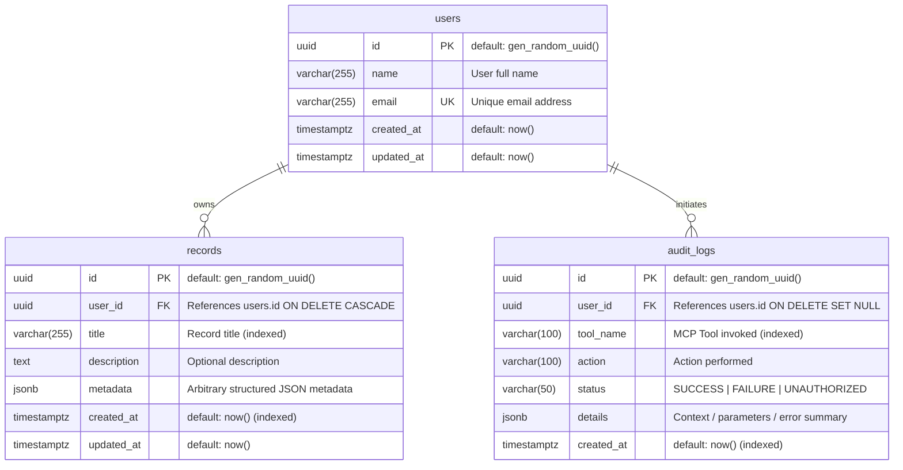

# Database Schema Documentation

This document describes the PostgreSQL database schema managed via Drizzle ORM and deployed to Neon PostgreSQL.

## Entity-Relationship (ER) Diagram



## Table Specifications

### 1. `users`
- **Primary Key**: `id` (`UUID`, generated via `gen_random_uuid()`)
- **Attributes**:
  - `name`: `VARCHAR(255)` NOT NULL
  - `email`: `VARCHAR(255)` UNIQUE NOT NULL
  - `created_at`: `TIMESTAMPTZ` NOT NULL DEFAULT `now()`
  - `updated_at`: `TIMESTAMPTZ` NOT NULL DEFAULT `now()`
- **Indexes**:
  - `users_email_idx` on `(email)`
  - `users_created_at_idx` on `(created_at)`

### 2. `records`
- **Primary Key**: `id` (`UUID`, generated via `gen_random_uuid()`)
- **Foreign Keys**:
  - `user_id` -> `users.id` (`ON DELETE CASCADE`)
- **Attributes**:
  - `title`: `VARCHAR(255)` NOT NULL
  - `description`: `TEXT` NULL
  - `metadata`: `JSONB` NOT NULL DEFAULT `'{}'`
  - `created_at`: `TIMESTAMPTZ` NOT NULL DEFAULT `now()`
  - `updated_at`: `TIMESTAMPTZ` NOT NULL DEFAULT `now()`
- **Indexes**:
  - `records_user_id_idx` on `(user_id)`
  - `records_created_at_idx` on `(created_at)`
  - `records_title_idx` on `(title)`

### 3. `audit_logs`
- **Primary Key**: `id` (`UUID`, generated via `gen_random_uuid()`)
- **Foreign Keys**:
  - `user_id` -> `users.id` (`ON DELETE SET NULL`)
- **Attributes**:
  - `tool_name`: `VARCHAR(100)` NOT NULL
  - `action`: `VARCHAR(100)` NOT NULL
  - `status`: `VARCHAR(50)` NOT NULL
  - `details`: `JSONB` NULL
  - `created_at`: `TIMESTAMPTZ` NOT NULL DEFAULT `now()`
- **Indexes**:
  - `audit_logs_user_id_idx` on `(user_id)`
  - `audit_logs_tool_name_idx` on `(tool_name)`
  - `audit_logs_created_at_idx` on `(created_at)`

## Multi-Tenancy & Authorization Security Rule
All records are strictly scoped by `user_id`. The service layer validates ownership on every operation (reading, listing, searching, updating, deleting), ensuring users can never access or modify records belonging to other users.

---

## Migration Notes

### Migration Strategy
Database migrations are defined using **Drizzle ORM** with **Drizzle Kit** and committed as reproducible SQL migration files in `drizzle/`.

1. **Migration File**: [`drizzle/0000_tired_cable.sql`](file:///e:/Nitrostack/Task%20second/drizzle/0000_tired_cable.sql)
   - Creates the `users`, `records`, and `audit_logs` tables.
   - Defines foreign key constraints (`ON DELETE CASCADE` on `records.user_id`, `ON DELETE SET NULL` on `audit_logs.user_id`).
   - Creates performance indexes:
     - `users_email_idx` on `users(email)`
     - `users_created_at_idx` on `users(created_at)`
     - `records_user_id_idx` on `records(user_id)`
     - `records_created_at_idx` on `records(created_at)`
     - `records_title_idx` on `records(title)`
     - `audit_logs_user_id_idx` on `audit_logs(user_id)`
     - `audit_logs_tool_name_idx` on `audit_logs(tool_name)`
     - `audit_logs_created_at_idx` on `audit_logs(created_at)`

2. **Applying Migrations**:
   Run the migration runner script:
   ```bash
   npm run db:migrate
   ```
   This executes [`src/db/migrate.ts`](file:///e:/Nitrostack/Task%20second/src/db/migrate.ts), connecting to Neon PostgreSQL over TLS and applying all pending migrations idempotently.

3. **Generating New Migrations**:
   When schema definitions change in [`src/db/schema.ts`](file:///e:/Nitrostack/Task%20second/src/db/schema.ts):
   ```bash
   npm run db:generate
   ```
   Drizzle Kit compares the TypeScript schema against the previous snapshot in `drizzle/meta` and outputs a new SQL file.

4. **Rollback Safety**:
   - Primary keys are non-sequential UUIDs generated by `gen_random_uuid()`.
   - Foreign key cascading ensures that deleting a user safely cleans up all associated records without leaving orphan rows.
   - Audit logs preserve historical records even if a user is deleted (`ON DELETE SET NULL`).


